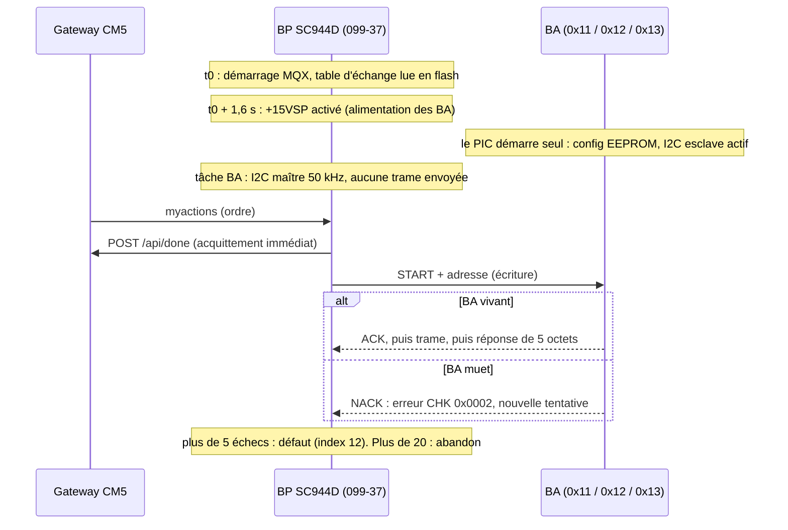

# Démarrage du BP et des BA : pourquoi seuls les deux boîtiers neufs dialoguent (analyse du 2026-10-14)

Version anonymisée : pas d'adresse IP, de MAC ni de numéro de série de l'installation.

## Contexte

Après la foudre du 9 août 2026, le boîtier principal (BP, SC944D, firmware 099-37) et le BA pièces de vie (SC940D, firmware v1.7) ont été remplacés. Les BA chambres (SC942C) et pièces d'eau (SC941C) sont restés en place.

Constats :
- le contrôle du 2026-10-12 donne index 12 = **0x18** : le BA chambres (0x12) et le BA pièces d'eau (0x13) sont en défaut, alors que le SC940D (0x11) répond ;
- le BP acquitte chaque action auprès de la gateway CM5 (`POST /api/done/{guid}`) **avant** de l'envoyer aux BA (`www.c:968-990`). La gateway croit donc l'ordre exécuté.

Question : comment se passe le démarrage du BP et des BA, et comment se fait-il que seuls les deux boîtiers neufs communiquent ensemble ?

Méthode :
- lecture du firmware BP 099-37, comparé aux archives 095-34, 096-35 et 097-36 ;
- lecture du firmware BA v1.7, identique dans les trois dépôts ;
- décodage des 22 fichiers `.hex` des BA, de la v1.10 à la v1.7 : présence du polynôme CRC `0xA001` et valeur chargée dans `SSPADD` ;
- recoupement avec le rapport d'analyse foudre (chaîne du bus, alimentation, console Espion).

## Réponse courte

1. **Il n'y a ni appairage, ni présentation, ni négociation de version** entre le BP et les BA.
   - Le BP appelle chaque BA à une adresse fixe (`0x11 + n`).
   - Un BA répond dès que son PIC est alimenté, tourne, et reconnaît son adresse.

   Rien dans le code ne permet à un boîtier neuf de « reconnaître » un autre boîtier neuf.
2. **Le bus est sain jusqu'au bout de la chaîne.** L'ordre du câble est BP → SC942C → SC941C → SC940D, et le SC940D est en bout de chaîne. Le SDA, le SCL et le +15 V qui le font fonctionner traversent les connecteurs J1/J2 des deux anciens BA.
3. **La différence vient donc des deux anciens BA eux-mêmes.** Par ordre de probabilité :
   - **Dégât électrique de la foudre**. Les causes possibles :
     - broches RC6/RC7 du PIC, reliées au connecteur par des résistances de 0 Ω ;
     - étage d'alimentation (U1, D3, C2, D6, FI1) ;
     - quartz.

     Les deux BA « d'apparence saine » ont subi le même courant d'équilibrage que le BA détruit.
   - **Firmware antérieur à la v1.5**, qui parle l'ancien protocole à somme de contrôle 8 bits, incompatible avec le BP 099-37. C'est peu probable si ces BA fonctionnaient avant la foudre avec un BP en version 095-34 ou plus récente, mais pas impossible.
4. **Deux contrôles sur place permettent de trancher, sans attendre l'espion I2C** : la LED de chaque BA et la console Espion du BP (voir « Vérifications sur place »).

## Démarrage du BP (firmware 099-37)

| Étape | Code | Effet |
|---|---|---|
| Attente initiale | `main.c:107` | 500 ms |
| Table d'échange | `main.c:146` | lue en flash (configuration d'usine sur un BP neuf) |
| Matériel | `main.c:161`, `Hard.c:267-273` | sortie `+15VSP_AlimBA` (port TE2) initialisée **à 0** : BA non alimentés |
| EEPROM SPI | `main.c:165-180` | MAC, clé d'accès à distance, code alarme |
| Attente | `main.c:184` | 1 s |
| **Alimentation des BA** | `main.c:187-188` | `+15VSP` à 1 : les BA démarrent environ 1,6 s après le BP |
| Applicatif | `main.c:208-216` | horloge, chauffage, alarme, timers |
| Tâches | `main.c:221-230` | écran, **BA**, téléinfo, Ethernet |

Tâche BA (`ba.c:59-148`) :
- ouverture de `i2c0:` en mode polled, **50 kHz**, maître, adresse propre `0x10` (`ba.c:79-112`, `application.h:8-9`) ;
- **la configuration n'est pas poussée au démarrage.** Le BP recopie la configuration de sa table dans son image locale (`ba.c:127-130`) : il considère les BA comme déjà à jour. Les trames de configuration (codes 2, 3, 4) ne partent que lorsqu'une valeur change ensuite ;
- les drapeaux ACTIONS (code 5 : secouru, blocage des volets, allumage forcé) partent à 0. Une trame code 5 ne part que si l'un d'eux change (`ba.c:157-212`) ;
- **après un démarrage, le bus reste donc silencieux jusqu'au premier ordre.** Un BA en panne n'est détecté que lorsqu'un ordre le vise.

Alimentation des BA et mode secouru (`Hard.c:879-946`) :
- secteur absent pendant 10 s : passage en mode secouru, et trame code 5 « secouru » (ordre de sauvegarde) ;
- 2 s plus tard, **`+15VSP` est coupé** et les BA s'éteignent ;
- retour du secteur : `+15VSP` est rétabli tout de suite ; le mode secouru prend fin 5 s plus tard.

Si le BP se croyait sur batterie, tous les BA seraient éteints. Ce n'est pas le cas ici, puisque le SC940D répond.

## Chemin d'un ordre jusqu'au BA

1. **Réception.** `www.c` reçoit `myactions` et écrit les valeurs dans la table d'échange, puis acquitte immédiatement la gateway (`www.c:968-990`).
2. **Mise en file.** La boucle principale appelle `vd_UpdateOrdresPilotageSortiesBA` (`main.c:372`, `ba.c:557-643`), qui place un message par BA dans la file de la tâche BA.
3. **Transaction.** La tâche BA appelle `sl_fct_write_polled` (`ba_i2c.c:37-512`) :
   - adresse `0x11 + n`, puis contrôle de l'ACK (`ba_i2c.c:228-262`). Un NACK lève l'erreur `CHK` (0x0002) ;
   - écriture de la trame `[code][données][CRC16 LE]` (`ba_i2c.c:269`) ;
   - repeated START, lecture de 5 octets (`ba_i2c.c:318-371`) ;
   - trois contrôles : écho du code (0x0080), CRC de la réponse (0x0100), écho du CRC émis (0x0400) (`ba_i2c.c:387-431`) ;
   - pause de 100 ms après chaque transaction (`ba_i2c.c:508`).
4. **Répétitions.** Le compteur `o_Repete` est commun à tous les types de trame d'un même BA (`ba.c:28-39`) :
   - plus de 5 échecs : `Defboitier` à 1, visible à l'index 12 (`ba.c:485-511`, `global.h:499`) ;
   - plus de 20 échecs : l'ordre est abandonné (`global.h:500`). Le compteur reste ensuite saturé : **un seul essai par nouvel ordre**, et le défaut ne retombe qu'après un échange réussi.
5. **Index 12** (`Information`, `main.c:1007-1016`) : bit 0x04 = pièces de vie (0x11), 0x08 = chambres (0x12), 0x10 = pièces d'eau (0x13).

## Démarrage d'un BA (firmware v1.7, PIC16F946)

- **Configuration du PIC.** Quartz 20 MHz, watchdog désactivé (`main.c:17`), reset de basse tension actif vers 2,1 V. Le PIC ne se relance pas tout seul après un plantage : les `CLRWDT` sont sans effet et la relance est commentée (`main.c:415-424`).
- **Séquence de démarrage** (`main.c:291-309`), sans attendre le BP et sans échange préalable :
  1. variables ;
  2. timer ;
  3. module I2C esclave : `SSPADD = adresse << 1`, `SSPCON = 0x36` (`hard.c:54-62`) ;
  4. type de bornier ;
  5. vérification de version EEPROM ;
  6. lecture de la configuration en EEPROM (valeurs par défaut si les marqueurs 0x55/0xAA sont absents) ;
  7. interruptions autorisées.
- **Tout l'I2C est traité en interruption** (`slavenode.c:133-362`).
  - L'ACK d'adresse est donné par le matériel ; le logiciel ne refuse jamais son adresse.
  - La longueur attendue dépend du code de trame (`slavenode.c:201-224`) : 11, 11, 19, 11 et 4 octets.
  - CRC-16/MODBUS (`crc.c`). Si le CRC est faux, l'écho vaut `00 00` (`slavenode.c:244-250`).
  - Si une trame valide arrive moins de 40 ms après la précédente, elle est acquittée mais ignorée (`slavenode.c:258-274`). Les 100 ms du BP l'évitent.
- **Aucune dépendance au BP.** Pas de test de version, pas de configuration exigée avant un forçage (code 1), pas de mode de repli si le BP se tait.
- **Au démarrage**, relais et variateurs reprennent leur état sauvegardé en EEPROM. La sauvegarde n'a lieu que sur l'ordre « secouru » (code 5).
- **LED DL1** : un bref éclair par seconde, **sans lien avec l'I2C** (`gestionsorties.c:15-31`). Elle prouve seulement que le PIC tourne à la bonne vitesse.
- **Quartz mort.** Le moniteur d'horloge bascule sur l'oscillateur interne à 31 kHz. Le BA tourne alors environ 640 fois plus lentement, ne suit plus un bus à 50 kHz, et sa LED reste presque figée.

## Historique du protocole I2C

Côté BP, `ba.c`, `ba_i2c.c` et `crc.c` sont identiques de 095-34 (2015-10) à 099-37 (2017-01) : tous en CRC16. Il reste dans le code des traces d'un ancien protocole à somme de contrôle 8 bits (`ba_i2c.c:20-33`, `ba.c:177`, `ba.c:241-243`).

Côté BA, version par version (décodage des `.hex`) :

| Version BA | Contrôle | Longueurs des trames (codes 1 à 5) | Réponse | Compatible BP 099-37 |
|---|---|---|---|---|
| 1.10 (Vie seulement) | aucun I2C | — | — | non : aucun accès au module I2C, donc NACK |
| 1.30, 1.31, 1.32, 1.4 | somme 8 bits | 10, 10, 18, 10, 3 | 3 octets, puis `55 55` | **non** : le BA acquitte son adresse, mais le BP lève l'erreur CRC (0x0100) et le BA n'exécute pas la commande |
| **1.5**, 1.6, 1.7 | CRC16 (0xA001) | 11, 11, 19, 11, 4 | 5 octets | oui |

Pour chaque type de carte, l'adresse est la même dans toutes les versions qui gèrent l'I2C : Vie en 0x11 (`SSPADD` 0x22), Chambre en 0x12 (0x24), Eau en 0x13 (0x26).

Chronologie déduite : 1.10, 1.30, 1.31, 1.32, 1.4, puis 1.5 (passage au CRC, entre mi-2013 et octobre 2015), 1.6 et 1.7.

**Pièges de reflashage :**
- seuls les fichiers `Prog/ba v1_7 <type>.hex` sont bons ;
- les `.hex` de `essensys_ba.X/dist/` sont identiques dans les trois dépôts et répondent tous en **0x12**, car `hard.h` définit `TYPE_CHAMBRES` partout ;
- même problème avec le build essensys-gcc.

## Ce qui peut rendre un BA muet, et comment le reconnaître

| Cause | Console Espion du BP (`ErreursDialogueBA[n]`) | Espion I2C | LED DL1 du BA |
|---|---|---|---|
| Broches RC6/RC7 ou module I2C du PIC détruits | 0x0002 (`CHK`, NACK d'adresse) | NACK sur 0x12 / 0x13 | clignote normalement |
| Alimentation du BA détruite (U1, D3, C2, D6, FI1) | 0x0002 | NACK | **éteinte** |
| Quartz mort (repli à 31 kHz) | 0x0002, ou réponses tronquées | NACK ou SCL étiré | **presque figée** |
| Plantage sans watchdog, ou tension entre 2,1 et 4,5 V | 0x0002 | NACK | figée ou erratique ; repart après une coupure du +15 V |
| Firmware antérieur à 1.5 (somme 8 bits) | 0x0100 (`CRC_REPONSE`) | ACK, réponse `xx yy zz 55 55` | clignote normalement |
| Firmware 1.10 sur un Vie, ou mauvaise adresse | 0x0002 | NACK sur l'adresse attendue, ACK ailleurs | clignote normalement |

Hypothèse écartée : un BA qui tiendrait SCL ou SDA bas bloquerait tout le bus, y compris le SC940D, qui répond.

## Vérifications sur place, dans l'ordre

Toutes ces vérifications sont passives. Tout branchement se fait hors tension, par une personne habilitée.

1. **LED DL1 du SC942C et du SC941C.**
   - Éteinte : alimentation du BA. Mesurer +VBUS sur J1-4, puis +12 V et +5 V sur la carte.
   - Figée : quartz ou plantage. Couper puis remettre le +15 V, puis observer.
   - Clignotement normal : le PIC tourne. Passer au point 2.
2. **Console Espion du BP** : `ErreursDialogueBA[1]` (chambres) et `[2]` (pièces d'eau).
   - 0x0002 : NACK, donc dégât matériel : broches du PIC ou PIC à remplacer.
   - 0x0100 : ancien firmware. Reflasher en `ba v1_7 <type>.hex`.

   Il faut d'abord souder R109/R110 et J102 sur le BP (UART2, TTL 3,3 V, 9 600 8N1). Voir le rapport foudre §3.3.
3. **Version de l'ancien BP**, s'il démarre encore : indices 0 et 1 de la table d'échange. Une version 095-34 ou plus récente implique des BA en 1.5 ou plus, ce qui écarte la piste du firmware.
4. **Espion I2C passif** dès réception des pièces : NACK, ou réponse `55 55`, sur 0x12 et 0x13.
5. **Isolement à 500 V continu des deux BA** avant toute remise en service (rapport foudre, essai n° 14).

## Pointeurs de code

- BP : `essensys-board-SC944D/SC944D/Prog/099-37/BP_MQX_ETH/` : `C/main.c`, `C/ba.c`, `C/ba_i2c.c`, `C/Hard.c`, `Ethernet/www.c`, `H/global.h`, `H/application.h`
- BA : `essensys-board-SC940/SC940D/Prog/code_ba (fichiers sources 1.7)/source/` : `main.c`, `hard.c`, `slavenode.c`, `crc.c`, `gestionsorties.c`, `traitement.c` (sources identiques dans SC941C et SC942C)
- Fichiers `.hex` des BA : `essensys-board-SC94{0,1C,2C}/*/Prog/` et `_Archives/`
- Rapport foudre : `raw/incidents/2026-08-foudre-bus-i2c/rapport-analyse.md` (§3.3 console Espion, §3.5 essais, chaîne du bus)
